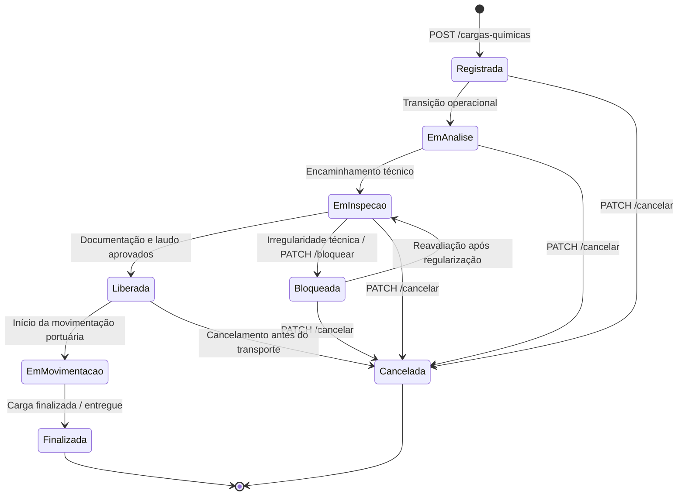

# FIAP QuimiPort - Tech Challenge (Fase 2)
### Sistema de Gestão de Cargas Químicas Portuárias (Porto de Santos)

---

## Integrantes do Grupo
* **Hans Oliveira** - RM: *(informe seu RM)*
* *(Adicione os demais integrantes do grupo aqui, se houver)*

---

## 1. Entendimento do Domínio e Contexto do Problema

**Contexto de Problema:** O Porto de Santos é um dos principais pontos de movimentação do Brasil, lidando com produtos químicos que exigem controle cuidadoso, acompanhamento técnico, documentação adequada e classificação de risco. Atualmente, o registro em empresas de controle é feito de forma manual ou descentralizada. Isso dificulta a consulta das informações, o rastreio do status da carga e a validação de regras de segurança essenciais.

**Resolução de problema:** O **QuimiPort** surge para solucionar esse cenário, oferecendo uma API backend centralizada e robusta para a gestão inicial dessas cargas, bloqueando ou liberando as operações de acordo com regras de negócio e de segurança portuária.

**Usuários Envolvidos:**
* **Operador portuário:** Atua no registro e na linha de frente da movimentação.
* **Responsável técnico:** Profissional que atesta a conformidade das cargas (CRQ).
* **Analista de documentação:** Encarregado de inserir e validar os documentos obrigatórios.
* **Analista de qualidade:** Responsável por avaliações e inspeções na carga.
* **Gestor operacional:** Supervisiona as cargas e o fluxo portuário.
* **Administrador do sistema:** Gerencia os cadastros primários de produtos e configurações.

**Informações Controladas:**
* Cadastro de produtos e suas respectivas classes de risco (código ONU / IMDG).
* Documentação obrigatória vinculada a cada carga química.
* Dados do responsável técnico habilitado pela carga.
* Status de andamento e histórico da máquina de estados da carga.
* Dados do remetente (empresa de origem da carga).

---

## 2. Modelagem com Domain Driven Design (DDD)

Para garantir que a complexidade do ecossistema portuário seja bem traduzida para o código, utilizamos os conceitos de DDD, mantendo as regras de negócio puras isoladas no núcleo da aplicação.

### Linguagem Ubíqua
* **Produto Químico:** O material de referência cadastrado no catálogo (especificações e classe de risco).
* **Carga Química:** Lote físico fechado que chega ao porto e requer movimentação.
* **Responsável Técnico:** Profissional legalmente capacitado que atesta a carga.
* **Documentação:** Conjunto de licenças e registros que comprovam a conformidade.
* **Inspeção:** Processo de avaliação física ou documental da equipe de qualidade.
* **Status da Carga:** O estado operacional dentro do fluxo portuário (Registrada, Em análise, Em inspeção, Liberada, Bloqueada, Em movimentação, Finalizada, Cancelada).
* **Remetente:** Empresa cliente de origem que envia a carga química.

### Entidades e Agregado Principal
* **Agregado Raiz (Root Entity) - Carga Química:** Orquestra todo o ciclo de vida do lote no porto, encapsula coleções de documentos e inspeções, e protege as transições de status através de invariantes de negócio.
* **Produto Químico:** Mantém especificações, código ONU, grupo de compatibilidade e status ativo/inativo.
* **Documento da Carga:** Guarda validade e status de aprovação de licenças.
* **Inspeção:** Registra pareceres técnicos e laudos periciais.
* **Responsável Técnico & Remetente:** Identificam tecnicamente e fiscalmente os atores da operação.

---

## 3. Regras de Negócio e Casos de Uso Implementados

1. **R1:** Um produto químico não pode ser cadastrado sem nome ou sem classe de risco.
2. **R2:** Um produto químico inativo **não pode** ser utilizado para registrar novas cargas.
3. **R3:** Toda carga química deve obrigatoriamente possuir um produto químico associado e ativo.
4. **R4:** A quantidade da carga deve ser estritamente maior que zero (`quantidade > 0`).
5. **R5:** Toda carga deve possuir identificação de responsável técnico informado.
6. **R6:** Uma carga química **não pode ser liberada** sem a documentação obrigatória validada.
7. **R7:** Cargas com status `Bloqueada` ficam terminantemente impedidas de entrar em movimentação.
8. **R8:** Uma carga com status `Cancelada` não pode ser liberada.
9. **R9:** Uma carga em `Em inspeção` não pode ser finalizada sem antes ser liberada.
10. **R10:** Cargas com status final (`Finalizada` ou `Cancelada`) não aceitam mais nenhuma alteração de status.

---

## 4. Tecnologias Utilizadas e Decisões Arquiteturais

* **Node.js (v20+ / v22 LTS)** com **TypeScript:** Garante tipagem estrita, modularidade ES6+ e segurança em tempo de compilação.
* **NestJS 12:** Framework escolhido por oferecer suporte nativo a Injeção de Dependências (IoC/DI), arquitetura modular corporativa, validação declarativa com DTOs (`class-validator`) e integração nativa com Swagger.
* **Onion / Clean Architecture:** Separação estrita em camadas:
  * `domain/`: Regras puras, entidades e contratos de repositórios.
  * `application/`: Casos de uso e serviços de orquestração.
  * `infrastructure/`: Persistência via Prisma ORM e MySQL, com fallback gracioso em memória temporária.
  * `presentation/`: Controllers REST, DTOs, filtros globais de exceção e interceptores de log.
* **MySQL 8.0 + Prisma ORM 6:** Banco relacional com integridade referencial, constraints de chave estrangeira (FK) e transações seguras. O Prisma gera tipagem ponta a ponta sem risco de inconsistências de schema.

---

## 5. Modelagem de Dados Relacional (MySQL)

| Tabela | Responsabilidade | Chaves e Relacionamentos |
| :--- | :--- | :--- |
| `produtos_quimicos` | Catálogo de produtos | `id` (PK UUID), `nome`, `classe_risco`, `status`, `numero_onu`, `grupo_compatibilidade`, `peso_unidade`, datas. |
| `cargas_quimicas` | Lotes físicos em trânsito | `id` (PK UUID), `codigo_carga`, `id_produto` (FK N:1 para `produtos_quimicos`), `quantidade`, `unidade_medida`, `origem`, `destino`, `responsavel_tecnico`, `documentacao_obrigatoria`, `status_atual`, `id_remetente` (FK), `id_responsavel_tecnico` (FK), datas. |
| `documentos_carga` | Licenças e conformidades | `id` (PK UUID), `id_carga` (FK N:1 para `cargas_quimicas`), `tipo_documento`, `data_validade`, `status_valido`. |
| `inspecoes` | Laudos da qualidade | `id` (PK UUID), `id_carga` (FK N:1 para `cargas_quimicas`), `status_inspecao`, `resultado`, `parecer_tecnico`. |
| `responsaveis_tecnicos`| Responsáveis com CRQ | `id` (PK UUID), `nome`, `registro_profissional`, `cpf`. |
| `remetentes` | Empresas clientes | `id` (PK UUID), `razao_social`, `cnpj`, `telefone`. |

---

## 6. Fluxo de Status da Carga Química (Máquina de Estados)



---

## 7. Documentação da API REST (Swagger)

A documentação interativa está disponível no Swagger UI através do endereço:
👉 **`http://localhost:3000/docs`**

### Principais Endpoints

#### Produtos Químicos (`/produtos-quimicos`)
* `POST /produtos-quimicos`: Cadastra novo produto químico.
* `GET /produtos-quimicos`: Lista todos os produtos (filtro opcional `?apenasAtivos=true`).
* `GET /produtos-quimicos/:id`: Busca produto químico por UUID.
* `PUT /produtos-quimicos/:id`: Atualiza dados cadastrais.
* `PATCH /produtos-quimicos/:id/inativar`: Inativação lógica do produto.
* `PATCH /produtos-quimicos/:id/reativar`: Reativação do produto.

#### Cargas Químicas (`/cargas-quimicas`)
* `POST /cargas-quimicas`: Registra nova carga física (status inicial `Registrada`).
* `GET /cargas-quimicas`: Lista cargas físicas (filtros por `status`, `idProduto`, `codigoCarga`).
* `GET /cargas-quimicas/:id`: Consulta dados completos de uma carga química.
* `PATCH /cargas-quimicas/:id/status`: Altera status da carga via máquina de estados.
* `PATCH /cargas-quimicas/:id/bloquear`: Bloqueia carga imediatamente por irregularidades.
* `PATCH /cargas-quimicas/:id/liberar`: Libera a carga (valida documentação obrigatória).
* `PATCH /cargas-quimicas/:id/cancelar`: Cancela a carga (impede operações futuras).
* `PATCH /cargas-quimicas/:id/documentacao`: Valida e anexa documentação obrigatória.

---

## 8. Logs e Observabilidade Inicial

* **`LoggingInterceptor`:** Interceptor HTTP global que registra no console todas as requisições recebidas com método, URL, status code e tempo de resposta em milissegundos (`[POST] /cargas-quimicas 201 - 14ms`).
* **`DomainExceptionFilter`:** Filtro de exceções que captura violações de regras de negócio (`BusinessRuleError`), gerando logs de advertência com timestamp e respondendo com payload amigável ao cliente.
* **Resiliência:** Repositórios com logs informativos e fallback automático em memória caso o MySQL não esteja ativo.

---

## 9. Pipeline de CI/CD com GitHub Actions

O arquivo `.github/workflows/ci.yml` automatiza a validação a cada `push` e `pull request`:
1. Checkout do código-fonte.
2. Instalação do Node.js v22 com cache npm.
3. Instalação limpa de dependências (`npm ci`).
4. Geração do Prisma Client (`npx prisma generate`).
5. Validação de linting e tipos (`npm run lint`).
6. Verificação de compilação do projeto (`npm run build`).
7. Execução dos testes automatizados (`npm test`).

---

## 10. Qualidade de Software e Testes Automatizados

A aplicação conta com **72 testes automatizados** utilizando **Vitest**, cobrindo todas as regras de negócio exigidas e validações de segurança:

```bash
# Executa todos os testes automatizados
npm test

# Executa testes em modo contínuo (watch)
npm run test:watch

# Gera relatório de cobertura de código
npm run test:cov

# Executa testes de ponta a ponta (e2e)
npm run test:e2e
```

---

## 11. Como Executar o Projeto

### Opção A: Execução com Docker Compose (Recomendado)

1. **Clone o repositório:**
   ```bash
   git clone https://github.com/Hans-Oliveira/FIAP-quimiport-tech-challenge-API.git
   cd FIAP-quimiport-tech-challenge-API
   ```

2. **Crie e configure o arquivo `.env`:**
   ```bash
   cp .env.example .env
   ```
   Abra o `.env` e preencha as variáveis de segurança do MySQL:
   ```dotenv
   PORT=3000
   MYSQL_ROOT_PASSWORD=senha_root_segura
   MYSQL_DATABASE=quimiport
   MYSQL_USER=quimiport_user
   MYSQL_PASSWORD=senha_usuario_segura
   DATABASE_URL="mysql://quimiport_user:senha_usuario_segura@db:3306/quimiport"
   ```

3. **Inicie os containers:**
   ```bash
   docker compose up --build -d
   ```

4. **Acesse:**
   * API: `http://localhost:3000`
   * Documentação Swagger: `http://localhost:3000/docs`

---

### Opção B: Execução Local Direta (Node.js)

1. Instale as dependências:
   ```bash
   npm install
   ```
2. Gere os modelos Prisma:
   ```bash
   npx prisma generate
   ```
3. Inicie o servidor em modo de desenvolvimento:
   ```bash
   npm run start:dev
   ```
4. Acesse o Swagger UI em `http://localhost:3000/docs`.

